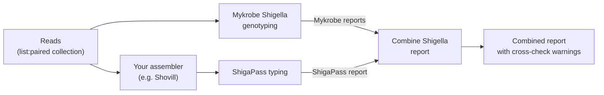

# *Shigella* Typing Tools

I redesigned three tools to give a more thorough *Shigella* report for
public health use, from genome assemblies and reads:

- **ShigaPass typing** is redesigned from
  [ShigaPass](https://github.com/imanyass/ShigaPass).
- **Mykrobe Shigella genotyping** is redesigned from
  [Mykrobe](https://github.com/Mykrobe-tools/mykrobe) and
  [mykrobeshig](https://github.com/ShigellaGenomics/mykrobeshig).
- **Combine Shigella report** joins the two into one report.

> **Prefer no command line?**
> [Genomics Workflow Microbials (GWM)](https://github.com/TinusTK/GenomicsWorkflowMicrobials)
> is a free desktop app for Windows, Mac and Linux with a point-and-click
> interface. ShigaPass typing is built in, with the Mykrobe genotyping and
> the combined report: choose a folder of reads, press Run and read the
> results as tables. Nothing to install by hand, and no server needed: it all runs locally on your computer.

Together they give:

- **species and serotype** (*Shigella* or EIEC) with ShigaPass on the assembly
- **genotype** for *S. sonnei* and *S. flexneri* with Mykrobe and the
  Sonneityping and Flex-It panels on the reads
- **ciprofloxacin-resistance (QRDR) mutations** in *gyrA* / *parC*
- one combined tabular report per run, with **cross-check warnings** when
  the assembly and reads disagree, and the tool and panel versions on every row

| Tool | Input | Output |
|---|---|---|
| ShigaPass typing | Assemblies (FASTA) | ShigaPass report (optionally the combined report) |
| Mykrobe Shigella genotyping | Reads (paired, single-end or ONT) | Mykrobe report |
| Combine Shigella report | Reports from the two tools above | Combined report with cross-check warnings |



Or in one step: *ShigaPass typing* with *Also run Mykrobe genotyping* takes
the assemblies and the reads and gives the same combined report.

The tools are for *Shigella* only. For *M. tuberculosis* use TB-Profiler;
for other Mykrobe species use the IUC `mykrobe_predict` tool.

> **QRDR mutations ≠ susceptibility result.** They are genotypic markers,
> not a replacement for antimicrobial susceptibility testing (AST). Confirm
> as per laboratory procedure.

---

Available on Galaxy Australia.

## Output

One tab-separated row per sample in `shigella_typing_report.tsv`. Example
with four samples, turned on its side here so it fits: an *S. sonnei*, an
*S. flexneri*, an *S. boydii* (no Mykrobe scheme, serotype only) and a
deliberate mix-up (*S. sonnei* assembly with *S. flexneri* reads) that gets
a warning.

| Column | ERR5976293 | ERR5952732 | ERR5888634 | SWAP_sonnei_asm_flex_reads |
|---|---|---|---|---|
| `rfb` | D | B1-5 | C2 | D |
| `rfb_hits` | 202 | 139 | 79 | 202 |
| `rfb_pct` | 70.6% | 93.3% | 48.2% | 70.6% |
| `mlst_st` | ST152 | ST245 | ST145 | ST152 |
| `fliC` | ShH25(ShH1cplx) | ShH2(ShH2cplx) | ShH57(ShH3cplx) | ShH25(ShH1cplx) |
| `crispr` | A-var0,27 | A-var3,x,16 | A-var2 | A-var0,27 |
| `ipaH` | ipaH+ | ipaH+ | ipaH+ | ipaH+ |
| `predicted_serotype` | SS | SF1-5 | SB2 | SS |
| `predicted_flexserotype` | - | 1b | - | - |
| `comments` |  |  |  |  |
| `species_shigapass` | S. sonnei | S. flexneri | S. boydii | S. sonnei |
| `serotype_shigapass` | - | S. flexneri 1b | S. boydii 2 | - |
| `mykrobe_scheme` | sonnei | flexneri | none matched | flexneri |
| `mykrobe_species_call` | S. sonnei | S. flexneri | Not E. coli/Shigella | S. flexneri |
| `genotype` | 3.7.25 | 1.2.2.5.3 | - | 1.2.2.5.3 |
| `genotype_name` | MSM4 | - | - | - |
| `genotype_confidence` | strong | strong | - | strong |
| `qrdr_mutations` | none | none | - | none |
| `num_qrdr` | 0 | 0 | - | 0 |
| `cipro_prediction` | no QRDR mutations | no QRDR mutations | - | no QRDR mutations |
| `mykrobe_susceptibility` | quinolones: S | ciprofloxacin: S | - | ciprofloxacin: S |
| `species_coverage` | 95.196 | 88.459 | - | 88.459 |
| `lowest_support_genotype_marker` | - | - | - | - |
| `poorly_supported_markers` | - | - | - | - |
| `additional_markers` | - | - | - | - |
| `warnings` |  |  | No Mykrobe genotyping scheme for S. boydii; serotype only | Discordant: ShigaPass S. sonnei, Mykrobe S. flexneri - check |
| `shigapass_version` | 1.5.0 | 1.5.0 | 1.5.0 | 1.5.0 |
| `mykrobe_version` | 0.13.0 | 0.13.0 | 0.13.0 | 0.13.0 |
| `mykrobe_panel_version` | 20210201 | 20250902 | sonnei 20210201; flexneri 20250902 | 20250902 |
| `tool_version` | 1.0.2 | 1.0.2 | 1.0.2 | 1.0.2 |

How to read it:

- **ERR5976293**: *S. sonnei* (ShigaPass and Mykrobe agree), genotype
  3.7.25 (MSM4), no QRDR mutations.
- **ERR5952732**: *S. flexneri* serotype 1b, genotype 1.2.2.5.3, no QRDR
  mutations.
- **ERR5888634**: *S. boydii* serotype 2. There is no Mykrobe scheme for
  *S. boydii*, so it gets a serotype only; the warning says this is expected.
- **SWAP_sonnei_asm_flex_reads**: the assembly is *S. sonnei* but the reads
  are *S. flexneri*, so the row is flagged as discordant.

The ShigaPass columns (`rfb` to `comments`) are ShigaPass's own fields;
`species_shigapass` and `serotype_shigapass` spell out its call. The Mykrobe
columns (`mykrobe_scheme` to `additional_markers`) come from Mykrobe and
mykrobeshig. A test run with missing reads, a missing assembly and
non-*Shigella* cases too is in
[`validation/phase5_combined_report.tsv`](validation/phase5_combined_report.tsv)
(made with 0.1.0, before the `mykrobe_susceptibility` column).

### Cross-check warnings

| Situation | Warning |
|---|---|
| ShigaPass *S. sonnei*, Mykrobe *S. flexneri* (or the reverse) | `Discordant: ShigaPass <call>, Mykrobe <species> - check` |
| ShigaPass *S. sonnei* / *S. flexneri* 1-5, Mykrobe none matched | `ShigaPass <call> but Mykrobe did not match the <scheme> scheme - check reads/assembly` |
| ShigaPass Not Shigella/EIEC, Mykrobe *S. sonnei* / *S. flexneri* | `Discordant: ShigaPass Not Shigella/EIEC, Mykrobe <species> - check assembly` |
| ShigaPass *S. boydii*, *S. dysenteriae*, *S. flexneri* 6 or EIEC, Mykrobe none matched | `No Mykrobe genotyping scheme for <species>; serotype only` (expected) |
| ShigaPass Not Shigella/EIEC and Mykrobe Not E. coli/Shigella | `Not Shigella - check organism` |
| Sample in one report only | `Missing from Mykrobe report` / `Missing from ShigaPass report` |
| Duplicate sample names | error listing the duplicates |

A warning is also added when species coverage is within 1 point of a
threshold, and when a tool could not run on a sample (the reason goes in
`warnings`; the sample still gets a row).

## Interpreting the results

- **QRDR calls.** `cipro_prediction` is `no QRDR mutations`,
  `QRDR mutation(s): reduced susceptibility likely` (1-2 mutations in
  *gyrA* / *parC*) or `QRDR triple mutant: resistance likely` (3 or more).
  `mykrobe_susceptibility` is Mykrobe's own call as it writes it:
  `ciprofloxacin: R/S` (*S. flexneri* panel) or `quinolones: R/S`
  (*S. sonnei* panel); Mykrobe calls R for any one QRDR mutation. The panels
  cover *gyrA* S83 / D87 and *parC* S80 only; plasmid-mediated quinolone
  resistance (*qnr*, *aac(6')-Ib-cr*, *qepA*) and other resistance genes are
  not detected, so S means no QRDR mutation was found, not that the isolate
  is susceptible.
- **Genotypes exist only for *S. sonnei* and *S. flexneri* serotypes 1-5.**
  *S. boydii*, *S. dysenteriae*, *S. flexneri* serotype 6 and EIEC get a
  species and serotype from ShigaPass but no Mykrobe genotype.
  *S. flexneri* 6 is genetically closer to *S. boydii* and is outside Flex-It.
- **`Not E. coli/Shigella`** from Mykrobe means the reads also missed
  Mykrobe's E. coli/Shigella check. This happens with some *S. boydii* and
  *S. dysenteriae*, as the panels are built for *S. sonnei* and
  *S. flexneri*: trust ShigaPass's species call for these.
- **EIEC and *Shigella*** are one pathotype of *E. coli*; ShigaPass separates
  them with *ipaH*, *rfb*, MLST, *fliC* and CRISPR markers. An `ipaH negative`
  call means neither *Shigella* nor EIEC.
- **Discordant calls** (ShigaPass says one species, Mykrobe another) usually
  mean a sample mix-up, contamination or a wrong pairing of reads and
  assembly: check before reporting.
- **Borderline species coverage** (within 1 point of the mykrobeshig
  threshold, *S. sonnei* 90, *S. flexneri* 85.5) is flagged; look at read
  depth and quality.
- **Panel versions** are in every row (`mykrobe_panel_version`): *S. sonnei*
  20210201 (Sonneityping) and *S. flexneri* 20250902 (Flex-It). Genotype
  names can change between panel versions; compare results made with the
  same versions.

## Using the tools in Galaxy

- **Mykrobe Shigella genotyping** runs per sample: map it over a
  `list:paired` collection (or single-end / Nanopore reads).
- **ShigaPass typing** takes all assemblies at once; with *Also run Mykrobe
  genotyping* it also takes the reads collection and writes the combined
  report.
- **Combine Shigella report** takes the ShigaPass report and the Mykrobe
  reports (a collection is fine).

Sample names are the collection element names, so keep them the same in
the reads and assembly branches. Example workflows (Galaxy Format2, import
via *Workflows > Import*): `workflows/shigella_typing_separate.gxwf.yml`
(three tools) and `workflows/shigella_typing_toggle.gxwf.yml` (one step).
Both take a reads collection and an assemblies collection; plug in your
own assembler.

## Validation

Mykrobe 0.13.0 with the bundled panels was checked against published
genotypes for 19 public read sets, and all three tools were run the Galaxy
way on 45 more public runs (mostly *S. boydii* and *S. dysenteriae*): every
run gave the expected result. See [`validation/PHASE0.md`](validation/PHASE0.md)
and the full report in
[`validation/set45_combined_report.tsv`](validation/set45_combined_report.tsv).
Resource use per sample (CPU, memory, runtime) is in
[`validation/PHASE6.md`](validation/PHASE6.md).

## Running without Galaxy

The Galaxy tools and the `shigella-typing` command use the same code and the
same bundled panels.

```bash
git clone https://github.com/TinusTK/shigella-typing
cd shigella-typing
conda env create -f environment.yml
conda activate shigella-typing
pip install -e .        # from the clone, so the bundled panels/ are found
shigella-typing --version
```

On macOS ShigaPass needs the GNU tools in `environment.yml`. Mykrobe never
downloads anything: it uses the bundled `panels/` (or point `--panels-dir` /
`SHIGELLA_TYPING_PANELS` at them).

**ShigaPass typing (assemblies)**

```bash
shigella-typing shigapass --assembly A.fasta B.fasta.gz --outdir out/ [--threads 4] \
    [--name A B] [--raw-outputs summary flex_summary]
```

Writes `out/shigapass_report.tsv`, one row per assembly. Sample names are
the file names without extensions unless `--name` is given. `--raw-outputs`
also keeps ShigaPass's own `ShigaPass_summary.csv` /
`ShigaPass_Flex_summary.csv`.

**Mykrobe Shigella genotyping (reads)**

```bash
shigella-typing mykrobe --reads S1_R1.fastq.gz S1_R2.fastq.gz --sample S1 --outdir out/ \
    [--scheme auto|sonnei|flexneri] [--ont] [--threads 4] [--raw-outputs json predictresults]
```

One sample per run (paired, single-end, or `--ont`). Writes
`out/mykrobe_report.tsv`. `auto` runs both schemes and keeps the one whose
species coverage reaches the mykrobeshig threshold (*S. sonnei* 90,
*S. flexneri* 85.5); otherwise `none matched` with Mykrobe's species call.

**Combine Shigella report**

```bash
shigella-typing combine --shigapass out/shigapass_report.tsv \
    --mykrobe out/*/mykrobe_report.tsv --outdir out/ [--strip-suffixes]
```

Joins the reports on `sample` (exact match; `--strip-suffixes` also ignores
`.fasta`, `_contigs`, ...) and writes `out/shigella_typing_report.tsv`.

**All in one**

```bash
shigella-typing shigapass --assembly A.fasta B.fasta --outdir out/ \
    --with-mykrobe --reads-samplesheet reads.tsv        # reads.tsv: sample, r1, r2
shigella-typing run --samplesheet samples.tsv --outdir out/   # sample, assembly, r1, r2
```

Both write the ShigaPass, Mykrobe and combined reports. Assemblies and reads
are matched by sample name; a sample with only one of them still gets a row.
Mykrobe tries the scheme matching the ShigaPass call first and runs the
other one too if it does not match, so the result is the same as running
the three tools separately ([`validation/PHASE5.md`](validation/PHASE5.md)).

Options: `shigella-typing <command> --help`.

Tests: `python -m unittest discover -s tests -v` (the end-to-end tests need
the conda environment and are skipped without it).

## Citation

- Yassine I. *et al.* (2023) ShigaPass: an *in silico* tool predicting
  *Shigella* serotypes from whole-genome sequencing assemblies.
  *Microb Genom*. doi:10.1099/mgen.0.000961 —
  https://github.com/imanyass/ShigaPass
- Hunt M. *et al.* (2019) Antibiotic resistance prediction for
  *Mycobacterium tuberculosis* from genome sequence data with Mykrobe.
  *Wellcome Open Res* 4:191. doi:10.12688/wellcomeopenres.15603.1
- mykrobeshig, ShigellaGenomics (adapted from sonneityping) —
  https://github.com/ShigellaGenomics/mykrobeshig
- Hawkey J. *et al.* (2021) Global population structure and genotyping
  framework for genomic surveillance of the major dysentery pathogen,
  *Shigella sonnei*. *Nat Commun* 12:2684. doi:10.1038/s41467-021-22700-4
- Hawkey J. *et al.* (2026) Flex-It: a global standardised genotyping
  framework for *Shigella flexneri*. *bioRxiv*. doi:10.64898/2026.04.17.719127
- Camacho C. *et al.* (2009) BLAST+: architecture and applications.
  *BMC Bioinformatics* 10:421.
- Mykrobe panel data, Mykrobe-tools — https://github.com/Mykrobe-tools/mykrobe-data
- Grüning B. *et al.* (2018) Bioconda: sustainable and comprehensive software
  distribution for the life sciences. *Nat Methods* 15:475–476.
- The Galaxy Community (2026) Galaxy for accessible, reproducible, and
  collaborative data analyses: 2026 update. *Nucleic Acids Res* 54(W1):W105–W116.
- TinusTK. *Shigella* Typing Tools. GitHub —
  https://github.com/TinusTK/shigella-typing

## Licence

GPL-3.0 (see [LICENSE](LICENSE)); it includes GPL-3.0 code from mykrobeshig.
